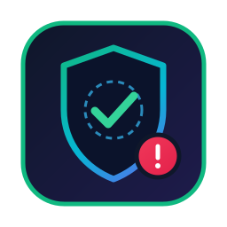
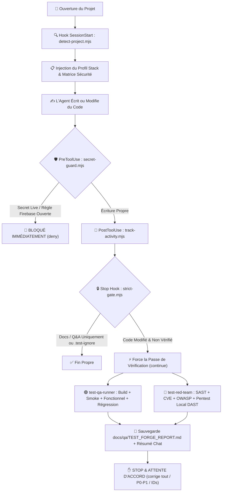

<div align="center">
  
  <h1>TestForge — Suite Autonome de QA & Tests de Sécurité</h1>
  <p><strong>Zéro Code Non Vérifié. Zéro Secret Exposé. Rapport & Accord Utilisateur Avant Chaque Correction.</strong></p>
  <p>
    <a href="./README.md">🇬🇧 English</a> &nbsp;|&nbsp;
    <strong>🇫🇷 Français</strong> &nbsp;|&nbsp;
    <a href="./README.tr.md">🇹🇷 Türkçe</a>
  </p>
</div>

---

## 📖 Table des Matières

1. [Philosophie — Pourquoi TestForge ?](#-1-philosophie--pourquoi-testforge)
2. [Architecture Visuelle & Hooks Automatisés](#-2-architecture-visuelle--hooks-automatisés)
3. [Compatibilité Multi-IDE (Antigravity, Claude Code, Codex, Cursor, Windsurf)](#-3-compatibilité-multi-ide)
4. [Installation & Désinstallation Globale](#-4-installation--désinstallation-globale)
5. [Les 7 Skills Modulaires & 2 Subagents Spécialisés](#-5-les-7-skills-modulaires--2-subagents-spécialisés)
6. [Matrice d'Auto-Détection par Stack](#-6-matrice-dauto-détection-par-stack)
7. [Mode Très Strict (Option A) & Contrat « Rapport d'Abord »](#-7-mode-très-strict-option-a--contrat-rapport-dabord)
8. [Synergie Zéro-Conflit avec SpecForge](#-8-synergie-zéro-conflit-avec-specforge)
9. [Auto-Tests & FAQ](#-9-auto-tests--faq)
10. [Licence](#-10-licence)

---

## 🎯 1. Philosophie — Pourquoi TestForge ?

Les assistants IA codent très vite — mais introduisent tout aussi vite des régressions silencieuses et des failles critiques :
- **Biais du développeur :** Demander au même agent qui vient d'écrire le code de « vérifier s'il est sécurisé » donne un audit superficiel.
- **Oubli des spécificités de stack :** Il faut constamment rappeler à l'IA de tester l'auth des *Server Actions* Next.js, le stockage chiffré Flutter, les endpoints Actuator Spring Boot, les règles Firestore ou la montée en charge.
- **Modifications non souhaitées :** Corriger silencieusement une faille de sécurité ou une règle métier sans l'accord du développeur peut casser une intention produit.

**TestForge résout ce problème grâce à 4 piliers automatisés :**
1. **Auto-Détection Instantanée (`SessionStart`) :** Dès l'ouverture d'un projet, TestForge identifie ta stack et assemble automatiquement la matrice de tests et de sécurité adaptée.
2. **Bouclier Temps Réel Secrets & P0 (`PreToolUse`) :** Bloque *avant l'écriture sur disque* tout secret en dur, clé privée ou règle Firebase ouverte en écriture publique.
3. **Porte de Vérification Stricte (`Stop` — Option A) :** L'agent ne peut pas terminer un tour de code sans avoir vérifié le build, lancé les tests + le scan sécurité et généré `docs/qa/TEST_FORGE_REPORT.md`.
4. **Rapport d'Abord & Accord Obligatoire :** L'agent corrige uniquement ses propres fautes de syntaxe/compilation sur le nouveau code, **jamais** les failles de sécurité ou bugs existants sans ton feu vert explicite.

---

## 🔄 2. Architecture Visuelle & Hooks Automatisés



---

## 🖥️ 3. Compatibilité Multi-IDE

TestForge fonctionne sur l'ensemble des environnements IA modernes :

| IDE / CLI IA | Skills (7) | Subagents (2) | Scripts CLI (SAST + Détecteur) | Hooks Natifs (4) | Règles Globales |
| :--- | :---: | :---: | :---: | :---: | :---: |
| **Google Antigravity** | ✅ Complet | ✅ Natifs | ✅ Intégrés | ✅ Les 4 Hooks | ✅ Toujours Actif |
| **Claude Code** | ✅ `~/.claude/skills` | ✅ `~/.claude/agents` | ✅ `~/.claude/test-forge/scripts` | ⚙️ `.claude-plugin` | ✅ Via `CLAUDE.md` |
| **OpenAI Codex** | ✅ `~/.codex/skills` + `~/.agents/skills` | ✅ Fallback Skills | ✅ `~/.agents/test-forge/scripts` | — | ✅ Via `AGENTS.md` |
| **Cursor** | ✅ `~/.cursor/skills` | ✅ Fallback Skills | ✅ `~/.agents/test-forge/scripts` | — | ✅ Via `.cursorrules` |
| **Windsurf** | ✅ `~/.codeium/windsurf/skills` | ✅ Fallback Skills | ✅ `~/.agents/test-forge/scripts` | — | ✅ Via rules |

---

## 📦 4. Installation & Désinstallation Globale

### ✨ Option 1 — Installation Sans Terminal (Copier-Coller à ton IA)

```text
Installe le plugin global et les skills TestForge depuis ce dépôt sur ma machine :
1. Clone le dépôt test-forge dans un dossier temporaire (ou utilise son dossier local).
2. Détecte mon OS et exécute "./install.sh" (macOS/Linux) ou "powershell -ExecutionPolicy Bypass -File .\install.ps1" (Windows) pour installer le plugin global, les 4 hooks stricts, les 2 subagents (test-red-team, test-qa-runner) et les 7 skills sur mes IDE IA.
3. Vérifie l'installation, lance "node --test tests/test-forge.test.mjs" pour confirmer que tous les tests passent, supprime le dossier temporaire et rappelle-moi de redémarrer mon IDE une fois.
```

### 🛠️ Option 2 — Installation Manuelle via Terminal

**macOS & Linux :**
```bash
git clone <URL_DE_TON_DEPOT_GITHUB> test-forge
cd test-forge
chmod +x install.sh && ./install.sh
```

**Windows (PowerShell) :**
```powershell
git clone <URL_DE_TON_DEPOT_GITHUB> test-forge
cd test-forge
powershell -ExecutionPolicy Bypass -File .\install.ps1
```

**Désinstallation propre :**
```bash
./install.sh --uninstall
# Windows :
powershell -ExecutionPolicy Bypass -File .\install.ps1 -Uninstall
```

---

## 🧩 5. Les 7 Skills Modulaires & 2 Subagents Spécialisés

### Subagents Dédiés (`agents/`)
* **🔴 `test-red-team` (Attaquant Éthique / Pentester)** : Auditeur indépendant qui n'a pas écrit ton code. Exécute un audit en **4 couches** (SAST, CVE, Architecture/RBAC/Firebase, Mini-Pentest local DAST avec PoC reproductibles). **Strictement en lecture seule** sur ton code de production.
* **🟢 `test-qa-runner` (Ingénieur QA Automation)** : Exécute les builds, tests unitaires, intégration, E2E, régression, smoke et charge dans un contexte isolé pour ne jamais polluer ta conversation.

### Les 7 Skills (`skills/`)
1. **`test-auto`** — Chef d'orchestre complet : détecte la stack, lance `test-qa-runner` + `test-red-team` en parallèle (ou séquentiellement sur Codex/Cursor), écrit `docs/qa/TEST_FORGE_REPORT.md` + résumé chat, attend ton accord.
2. **`test-security`** — Forteresse Sécurité 4 couches (SAST, Secrets, CVE, OWASP Web/API/Mobile, Firebase Rules, Spring Security, Pentest local `localhost`).
3. **`test-functional`** — Tests fonctionnels boîte noire (entrées valides/invalides, sorties, transitions d'états), E2E et non-régression.
4. **`test-performance`** — Tests de Charge (*Load*) et de Résistance (*Stress*) via `k6`, `Locust`, `Autocannon` + détection des requêtes N+1 et goulets d'étranglement.
5. **`test-smoke-sanity`** — Tests de fumée (`< 60s` post-build) et tests de cohérence ciblés (post-correctif).
6. **`test-parity`** — Tests *Back-to-Back* (parité iOS vs Android, v1 vs v2) et Tests en Parallèle / Audit (migrations & calculs financiers exacts).
7. **`test-resilience`** — Installation propre, vérification des variables `.env`, matrice de configuration, et tests de reprise après panne (*Recovery/Restore*).

---

## 🎯 6. Matrice d'Auto-Détection par Stack

| Stack détectée | Contrôles Sécurité activés automatiquement | Tests QA & Perf activés |
| :--- | :--- | :--- |
| **Web (Next.js / React / Vue / Svelte)** | Fuites `NEXT_PUBLIC_*`, auth Server Actions & API Routes, XSS (`dangerouslySetInnerHTML`), CSRF, SSRF, headers CSP/HSTS, `npm audit`. | `tsc --noEmit`, Vitest/Jest, Playwright/Cypress, Smoke routes. |
| **Mobile (Flutter / React Native / Expo)** | Secrets dans le bundle, `SharedPreferences`/`AsyncStorage` non chiffré, `usesCleartextTraffic`, `NSAllowsArbitraryLoads`, Deep Links. | `flutter analyze && flutter test` / Jest RN, parité iOS/Android. |
| **Backend (Node / Python / Spring Boot / Go)** | Injections SQL/NoSQL/Shell, IDOR & escalade RBAC, vérification JWT, CORS + credentials, Spring Actuator, `pickle`/`yaml.load`, Rate Limiting, CVE, Pentest local. | Tests API unitaires/intégration, Charge & Stress (`k6`/`Locust`), reprise BDD. |
| **Firebase** | Audit `firestore.rules` & `storage.rules` (default deny, parité create/update, `hasOnly`, limites DoS), auth Cloud Functions. | Tests Emulator Suite, Smoke. |
| **Docker & Autres (Rust, PHP, Desktop...)** | `USER` non-root, tags épinglés, `.env` vs `.gitignore`, scanner OWASP générique. | Build propre, Smoke & Régression. |

---

## 🛡️ 7. Mode Très Strict (Option A) & Contrat « Rapport d'Abord »

* **Auto-correction autorisée UNIQUEMENT pour :** Les erreurs simples de syntaxe, d'import ou de typage dans le **nouveau code tout juste écrit** par l'agent durant la tâche.
* **Accord OBLIGATOIRE avant toute correction de :** Failles de sécurité (`P0`–`P3`), bugs préexistants, logique métier, règles Firebase/RBAC ou mises à jour de dépendances.
* **Double sortie :** Rapport détaillé persistant dans **`docs/qa/TEST_FORGE_REPORT.md`** + résumé clair dans le chat (Score Qualité `/100`, Score Sécurité `/100`, anomalies classées `SEC-01`, `FUNC-01`...) + attente explicite (`corrige tout`, `corrige P0/P1`, ou liste d'IDs).
* **Garantie anti-boucle :** Le hook `Stop` force une passe de vérification si du code a été modifié sans être testé, puis laisse l'agent s'arrêter proprement une fois le rapport présenté.

---

## 🔗 8. Synergie Zéro-Conflit avec SpecForge

TestForge et **[SpecForge](https://github.com/Ismael-sang98/spec-forge-skill)** sont deux plugins frères **100 % indépendants** :
* **SpecForge sans TestForge :** Fonctionne parfaitement sans aucune dépendance.
* **TestForge sans SpecForge :** Fonctionne parfaitement sur n'importe quel projet.
* **Les deux activés ensemble :**
  * Zéro collision de hooks (`test-forge-*` vs `spec-forge-smart-gate`).
  * TestForge reste **totalement silencieux** pendant la phase `spec-init` (écriture de `.md` dans `docs/`).
  * Les rapports sont enregistrés dans `docs/qa/TEST_FORGE_REPORT.md` (dossier explicitement autorisé par `spec-forge`) et l'état interne est stocké hors du projet dans `$PLUGIN_DATA`.
  * **Bonus en lecture seule :** Si `docs/01_PRD.md`, `docs/04_API.md`, `docs/09_RBAC.md` ou `docs/PROD_CONFIG.md` existent, TestForge s'en sert pour vérifier que tes tests et tes règles d'accès correspondent exactement à tes spécifications.

> 💡 **Envie du workflow complet Spec-Driven + QA Automatisée ?** Télécharge et installe **SpecForge** à tout moment ici : 👉 **[https://github.com/Ismael-sang98/spec-forge-skill](https://github.com/Ismael-sang98/spec-forge-skill)**

---

## 🧪 9. Auto-Tests & FAQ

Lancer la suite de tests intégrée (zéro dépendance, Node.js 18+) :
```bash
node --test tests/test-forge.test.mjs
```

**Comment ignorer le mode strict sur un petit script jetable ?**  
Crée un fichier vide `.test-ignore` à la racine du projet, ou dis simplement *"skip test-forge"*.

---

## 📄 10. Licence

Licence MIT — voir [LICENSE](./LICENSE).
