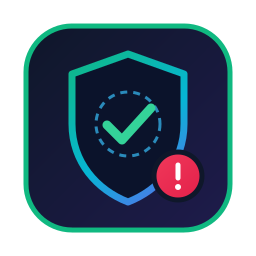
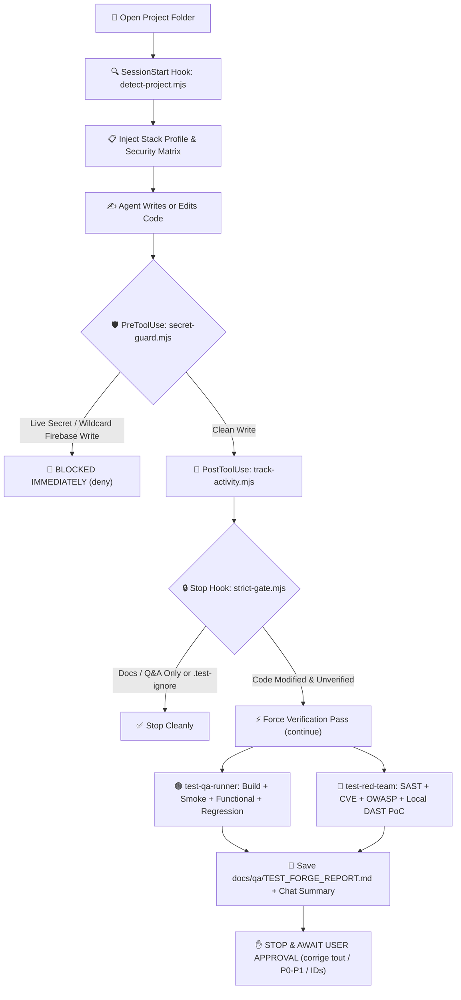

<div align="center">
  
  <h1>TestForge — Autonomous QA & Security Testing Suite</h1>
  <p><strong>Zero Unverified Code. Zero Leaked Secrets. Report-First Approval Before Every Fix.</strong></p>
  <p>
    <strong>🇬🇧 English</strong> &nbsp;|&nbsp;
    <a href="./README.fr.md">🇫🇷 Français</a> &nbsp;|&nbsp;
    <a href="./README.tr.md">🇹🇷 Türkçe</a>
  </p>
</div>

---

## 📖 Table of Contents

1. [Philosophy — Why TestForge?](#-1-philosophy--why-testforge)
2. [Visual Architecture & Lifecycle Hooks](#-2-visual-architecture--lifecycle-hooks)
3. [Cross-IDE Compatibility Matrix](#-3-cross-ide-compatibility-matrix)
4. [Global Installation & Uninstallation](#-4-global-installation--uninstallation)
5. [The 7 Modular Skills & 2 Dedicated Subagents](#-5-the-7-modular-skills--2-dedicated-subagents)
6. [Auto-Detected Stack & Security Matrix](#-6-auto-detected-stack--security-matrix)
7. [Option A Strict Mode & Report-First Contract](#-7-option-a-strict-mode--report-first-contract)
8. [Zero-Conflict Synergy with SpecForge](#-8-zero-conflict-synergy-with-specforge)
9. [Running the Built-In Self-Tests & FAQ](#-9-running-the-built-in-self-tests--faq)
10. [License](#-10-license)

---

## 🎯 1. Philosophy — Why TestForge?

AI coding assistants write features fast — and ship silent bugs, regressions, and security vulnerabilities just as fast:
- **Developer Bias:** Asking the same agent that just wrote a route to "check if it's secure" produces superficial reviews.
- **Stack Amnesia:** Developers constantly have to remember to ask for Next.js Server Action auth checks, Flutter SecureStorage checks, Spring Actuator lockdown, Firebase Rules parity, or k6 load tests.
- **Silent Over-Editing:** Some automated tools silently rewrite security or business logic without asking the developer first.

**TestForge solves this permanently with 4 automated pillars:**
1. **Instant Stack Auto-Detection (`SessionStart`):** The moment a workspace opens, TestForge knows your exact stack and builds the tailored QA & security matrix automatically.
2. **Real-Time Secret & P0 Shield (`PreToolUse`):** Hardcoded live secrets, private keys, and public-write Firebase rules are blocked *before* touching disk.
3. **Strict Verification Gate (`Stop` — Option A):** Modified code cannot be declared "done" until verification + security scanning have run and `docs/qa/TEST_FORGE_REPORT.md` has been generated.
4. **Report-First Approval:** TestForge auto-fixes only trivial syntax/compile errors in brand-new code, **never** silently alters security/business logic — it always shows the scored report first and waits for your approval.

---

## 🔄 2. Visual Architecture & Lifecycle Hooks



---

## 🖥️ 3. Cross-IDE Compatibility Matrix

TestForge is built for universal compatibility across modern AI coding UIs and CLIs:

| AI IDE / CLI | Skills (7) | Subagents (2) | CLI Scripts (SAST + Detector) | Native Lifecycle Hooks (4) | Global Rules |
| :--- | :---: | :---: | :---: | :---: | :---: |
| **Google Antigravity** | ✅ Full | ✅ Native | ✅ Bundled | ✅ All 4 Hooks | ✅ Always-On |
| **Claude Code** | ✅ `~/.claude/skills` | ✅ `~/.claude/agents` | ✅ `~/.claude/test-forge/scripts` | ⚙️ `.claude-plugin` | ✅ Via `CLAUDE.md` |
| **OpenAI Codex** | ✅ `~/.codex/skills` + `~/.agents/skills` | ✅ Skill fallback | ✅ `~/.agents/test-forge/scripts` | — | ✅ Via `AGENTS.md` |
| **Cursor** | ✅ `~/.cursor/skills` | ✅ Skill fallback | ✅ `~/.agents/test-forge/scripts` | — | ✅ Via `.cursorrules` |
| **Windsurf** | ✅ `~/.codeium/windsurf/skills` | ✅ Skill fallback | ✅ `~/.agents/test-forge/scripts` | — | ✅ Via rules |

---

## 📦 4. Global Installation & Uninstallation

### ✨ Option 1 — Zero-Terminal AI Prompt (Copy & Paste into Your AI)

```text
Install the TestForge global plugin & skills from this repository on my machine:
1. Clone the test-forge repository into a temporary directory (or use its local folder).
2. Detect my OS and run "./install.sh" (macOS/Linux) or "powershell -ExecutionPolicy Bypass -File .\install.ps1" (Windows) so the global plugin, 4 strict hooks, 2 subagents (test-red-team, test-qa-runner), and 7 skills are installed across my AI IDE(s).
3. Verify the installation, run "node --test tests/test-forge.test.mjs" to confirm all scripts pass, clean up any temporary clone, and remind me to restart my IDE once.
```

### 🛠️ Option 2 — Manual Terminal Installation

**macOS & Linux:**
```bash
git clone <YOUR_GITHUB_REPO_URL> test-forge
cd test-forge
chmod +x install.sh && ./install.sh
```

**Windows (PowerShell):**
```powershell
git clone <YOUR_GITHUB_REPO_URL> test-forge
cd test-forge
powershell -ExecutionPolicy Bypass -File .\install.ps1
```

**Uninstall cleanly at any time:**
```bash
./install.sh --uninstall
# Windows:
powershell -ExecutionPolicy Bypass -File .\install.ps1 -Uninstall
```

---

## 🧩 5. The 7 Modular Skills & 2 Dedicated Subagents

### Dedicated Subagents (`agents/`)
| Subagent | Role | Write Policy |
| :--- | :--- | :--- |
| **`test-red-team`** | Independent White-Hat / Red-Team Security Auditor (4-layer SAST, SCA/CVE, Architecture/RBAC/Firebase, Local DAST PoC). | Strictly **Read-Only** on production code. Zero developer bias. |
| **`test-qa-runner`** | Dedicated QA Automation Engineer running builds, unit/integration/E2E, regression, smoke, and load tests cleanly. | Fixes syntax only in newly written test files; reports all app defects. |

### Modular Skills (`skills/`)
| Skill | When It Runs / What It Covers |
| :--- | :--- |
| **`test-auto`** | Master orchestrator: detects stack, runs QA + Red-Team in parallel (or sequentially in single-agent IDEs), writes `docs/qa/TEST_FORGE_REPORT.md`, summarizes in chat, waits for approval. |
| **`test-security`** | Full 4-layer Security Fortress: SAST (`static-sec-scan.mjs`), secrets, CVE audit, OWASP Top 10, Firebase Rules, Mobile storage, Spring Security, and local `localhost` DAST pentest probes. |
| **`test-functional`** | Black-box functional testing (allowed inputs, rejected/negative inputs, outputs, state transitions), E2E, and full regression protection. |
| **`test-performance`** | Load Testing (peak traffic) & Stress Testing (breaking points) using `k6`, `Locust`, `Autocannon`, plus static N+1 / unbounded query profiling. |
| **`test-smoke-sanity`** | Fast `< 60s` Smoke Tests (post-build health) and targeted Sanity Tests (post-bugfix verification). |
| **`test-parity`** | Back-to-Back Testing (iOS vs. Android, v1 vs. v2) and Parallel / Audit Testing (migrations & exact financial calculation parity). |
| **`test-resilience`** | Clean-room Installation & `.env` contract checks, Configuration Matrix testing, and Recovery / Restore simulation (DB disconnect, transaction rollback, idempotency). |

---

## 🎯 6. Auto-Detected Stack & Security Matrix

`scripts/detect-project.mjs` automatically recognizes and adapts to:

| Stack | Automated Security Checks | Automated QA & Verification |
| :--- | :--- | :--- |
| **Web (Next.js / React / Vue / Svelte)** | `NEXT_PUBLIC_*` secret leaks, Server Actions & API Route auth, XSS (`dangerouslySetInnerHTML`), CSRF, SSRF, CSP/HSTS headers, `npm audit`. | `tsc --noEmit`, Vitest/Jest, Playwright/Cypress E2E, Smoke routes. |
| **Mobile (Flutter / React Native / Expo)** | Hardcoded bundle secrets, unencrypted `SharedPreferences`/`AsyncStorage`, `usesCleartextTraffic`, `NSAllowsArbitraryLoads`, deep link validation. | `flutter analyze && flutter test` / Jest RN, Back-to-Back iOS/Android parity. |
| **Backend (Node / Python / Spring Boot / Go)** | SQL/NoSQL/Shell injection, IDOR & RBAC privilege escalation, JWT verification, CORS + credentials, Spring Actuator exposure, `pickle`/`yaml.load`, Rate Limiting, CVE audits, local DAST pentest. | Unit/Integration API tests, `k6`/`Locust` Load & Stress tests, DB failure recovery. |
| **Firebase** | `firestore.rules` & `storage.rules` audit (default deny, create/update parity, `hasOnly`, DoS bounds), Cloud Functions auth checks. | Firebase Emulator Suite rules tests, Smoke checks. |
| **Docker & Generic (Rust, PHP, Desktop...)** | Non-root `USER`, pinned image tags, `.env` vs `.gitignore` hygiene, generic OWASP scanner. | Clean build verification, Smoke & Regression. |

---

## 🛡️ 7. Option A Strict Mode & Report-First Contract

1. **Auto-Fix Allowed ONLY for:** Trivial compile, type, or syntax errors in brand-new code the agent just wrote during the current task.
2. **Approval ALWAYS Required Before Fixing:** Any security vulnerability (`P0`–`P3`), any pre-existing bug, failing business logic, dependency upgrade, or security rule change.
3. **Dual Output:** Full persistent report saved to **`docs/qa/TEST_FORGE_REPORT.md`** + concise executive summary in chat with Quality Score (`/100`), Security Score (`/100`), prioritized findings (`SEC-01`, `FUNC-01`...), and an approval prompt (`corrige tout` / `corrige P0/P1` / specific IDs).
4. **Anti-Loop Guarantee:** The `Stop` hook enforces one verification pass when code was modified without testing, then cleanly lets the agent stop to present the report and await your approval — zero infinite loops.

---

## 🔗 8. Zero-Conflict Synergy with SpecForge

TestForge and **[SpecForge](https://github.com/Ismael-sang98/spec-forge-skill)** are 100% independent sibling plugins:
- **TestForge without SpecForge:** Works completely standalone on any repository.
- **SpecForge without TestForge:** Works completely standalone with zero changes.
- **Both installed together:**
  - Distinct hook namespaces (`test-forge-*` vs `spec-forge-smart-gate`).
  - TestForge stays **100% silent** during documentation-only turns (such as `spec-init` writing `docs/*.md`).
  - Internal state lives in `$PLUGIN_DATA` (zero repo clutter); reports save to `docs/qa/TEST_FORGE_REPORT.md` (explicitly allowed by SpecForge).
  - **Read-Only Synergy Bonus:** When `docs/01_PRD.md`, `docs/04_API.md`, `docs/09_RBAC.md`, or `docs/PROD_CONFIG.md` exist, TestForge cross-checks your tests and RBAC security against those exact specs.

> 💡 **Want the complete Spec-Driven + Automated QA workflow?** Download and install **SpecForge** anytime here: 👉 **[https://github.com/Ismael-sang98/spec-forge-skill](https://github.com/Ismael-sang98/spec-forge-skill)**

---

## 🧪 9. Running the Built-In Self-Tests & FAQ

Verify all TestForge hooks, detectors, and security scanners locally with zero dependencies (Node.js 18+):
```bash
node --test tests/test-forge.test.mjs
```

**Can I bypass Strict Mode for a tiny throwaway script?**  
Yes — create an empty `.test-ignore` file at the root of that folder, or tell the agent *"skip test-forge"*.

**Can I run the security scanner manually in CI/CD (GitHub Actions)?**  
Yes! Run:
```bash
node scripts/static-sec-scan.mjs /path/to/project --json
```

---

## 📄 10. License

MIT License — see [LICENSE](./LICENSE).
