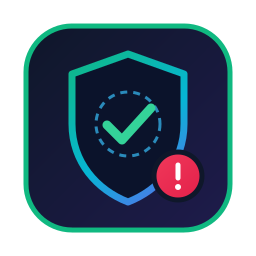
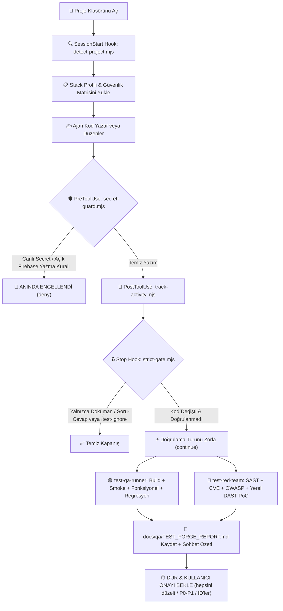

<div align="center">
  
  <h1>TestForge — Otonom QA & Güvenlik Test Paketi</h1>
  <p><strong>Doğrulanmamış Kod Yok. Sızdırılmış Gizli Anahtar Yok. Düzeltmeden Önce Rapor & Kullanıcı Onayı.</strong></p>
  <p>
    <a href="./README.md">🇬🇧 English</a> &nbsp;|&nbsp;
    <a href="./README.fr.md">🇫🇷 Français</a> &nbsp;|&nbsp;
    <strong>🇹🇷 Türkçe</strong>
  </p>
</div>

---

## 📖 İçindekiler

1. [Felsefe — Neden TestForge?](#-1-felsefe--neden-testforge)
2. [Görsel Mimari & Otomatik Hook'lar](#-2-görsel-mimari--otomatik-hooklar)
3. [Çoklu IDE Uyumluluğu (Antigravity, Claude Code, Codex, Cursor, Windsurf)](#-3-çoklu-ide-uyumluluğu)
4. [Global Kurulum & Kaldırma](#-4-global-kurulum--kaldırma)
5. [7 Modüler Skill & 2 Uzman Subagent](#-5-7-modüler-skill--2-uzman-subagent)
6. [Otomatik Teknoloji ve Güvenlik Matrisi](#-6-otomatik-teknoloji-ve-güvenlik-matrisi)
7. [Sıkı Mod (Seçenek A) & Önce Rapor Kuralı](#-7-sıkı-mod-seçenek-a--önce-rapor-kuralı)
8. [SpecForge ile Sıfır Çakışmalı Uyum](#-8-specforge-ile-sıfır-çakışmalı-uyum)
9. [Dahili Testler & SSS](#-9-dahili-testler--sss)
10. [Lisans](#-10-lisans)

---

## 🎯 1. Felsefe — Neden TestForge?

Yapay zekâ kodlama asistanları özellikleri çok hızlı yazar; ancak regresyon hatalarını ve güvenlik açıklarını da aynı hızla üretebilir. **TestForge** bunu 4 otomatik katmanla kalıcı olarak çözer:

1. **Anında Proje Algılama (`SessionStart`):** Proje açılır açılmaz teknoloji yığınını (Web, Mobil, Backend, Firebase, Docker vb.) algılar ve uygun test/güvenlik matrisini oluşturur.
2. **Gerçek Zamanlı Gizli Anahtar & P0 Kalkanı (`PreToolUse`):** Canlı API anahtarlarını, özel anahtarları (PEM) ve tehlikeli açık Firebase kurallarını diske yazılmadan anında engeller.
3. **Sıkı Doğrulama Kapısı (`Stop` — Seçenek A):** Kod değiştirildiğinde build/test ve güvenlik taraması çalıştırılmadan ve `docs/qa/TEST_FORGE_REPORT.md` oluşturulmadan ajanın turu bitirmesine izin vermez.
4. **Önce Rapor, Sonra Onaylı Düzeltme:** Ajan yalnızca yeni yazdığı koddaki basit sözdizimi/derleme hatalarını otomatik düzeltir; güvenlik açıkları ve mevcut mantık hataları için **daima rapor sunar ve onayınızı bekler**.

---

## 🔄 2. Görsel Mimari & Otomatik Hook'lar



---

## 🖥️ 3. Çoklu IDE Uyumluluğu

| AI IDE / CLI | Skiller (7) | Subagent'lar (2) | CLI Scriptleri | Doğal Hook'lar (4) | Global Kurallar |
| :--- | :---: | :---: | :---: | :---: | :---: |
| **Google Antigravity** | ✅ Tam | ✅ Doğal | ✅ Dahili | ✅ 4 Hook | ✅ Her Zaman Aktif |
| **Claude Code** | ✅ `~/.claude/skills` | ✅ `~/.claude/agents` | ✅ `~/.claude/test-forge/scripts` | ⚙️ `.claude-plugin` | ✅ `CLAUDE.md` |
| **OpenAI Codex** | ✅ `~/.codex/skills` + `~/.agents/skills` | ✅ Skill uyumlu | ✅ `~/.agents/test-forge/scripts` | — | ✅ `AGENTS.md` |
| **Cursor** | ✅ `~/.cursor/skills` | ✅ Skill uyumlu | ✅ `~/.agents/test-forge/scripts` | — | ✅ `.cursorrules` |
| **Windsurf** | ✅ `~/.codeium/windsurf/skills` | ✅ Skill uyumlu | ✅ `~/.agents/test-forge/scripts` | — | ✅ Kurallar |

---

## 📦 4. Global Kurulum & Kaldırma

**macOS & Linux:**
```bash
git clone <GITHUB_REPO_URL> test-forge
cd test-forge
chmod +x install.sh && ./install.sh
```

**Windows (PowerShell):**
```powershell
git clone <GITHUB_REPO_URL> test-forge
cd test-forge
powershell -ExecutionPolicy Bypass -File .\install.ps1
```

**Kaldırmak için:**
```bash
./install.sh --uninstall
```

---

## 🧩 5. 7 Modüler Skill & 2 Uzman Subagent

* **🔴 `test-red-team`:** Bağımsız Etik Hacker / Red-Team Denetçisi (4 katmanlı güvenlik denetimi, üretim kodunu asla izinsiz değiştirmez).
* **🟢 `test-qa-runner`:** İzole bağlamda build, birim/entegrasyon/E2E, regresyon, duman ve yük testlerini yürüten QA Mühendisi.
* **Skiller:** `test-auto`, `test-security`, `test-functional`, `test-performance`, `test-smoke-sanity`, `test-parity`, `test-resilience`.

---

## 🎯 6. Otomatik Teknoloji ve Güvenlik Matrisi

Desteklenen ana yığınlar: **Web (Next.js / React / Vue / Svelte)**, **Mobil (Flutter / React Native / Expo)**, **Backend (Node.js / Python / Spring Boot / Go)**, **Firebase (Firestore/Storage Rules & Functions)**, **Docker** ve diğer diller (Rust, PHP, Desktop vb.).

---

## 🛡️ 7. Sıkı Mod (Seçenek A) & Önce Rapor Kuralı

* Yeni yazılan koddaki basit sözdizimi/tip hataları otomatik düzeltilir.
* Güvenlik açıkları (`P0`–`P3`) ve mevcut mantık hataları **asla onaysız değiştirilmez**; önce **`docs/qa/TEST_FORGE_REPORT.md`** dosyasına kaydedilir, sohbette özetlenir ve onay beklenir.

---

## 🔗 8. SpecForge ile Sıfır Çakışmalı Uyum

TestForge ve **[SpecForge](https://github.com/Ismael-sang98/spec-forge-skill)** %100 bağımsız kardeş eklentilerdir:
* **SpecForge olmadan TestForge:** %100 bağımsız çalışır.
* **TestForge olmadan SpecForge:** %100 bağımsız çalışır.
* **Birlikte kullanıldığında:** `spec-init` doküman yazımında TestForge sessiz kalır; raporlar SpecForge'un izin verdiği `docs/qa/` dizinine yazılır; `docs/01_PRD.md`, `docs/09_RBAC.md` gibi dosyalar varsa salt-okunur çapraz doğrulama için kullanılır.

> 💡 **Tam Spec-Driven + Otonom QA iş akışını ister misiniz?** **SpecForge** eklentisini istediğiniz zaman buradan indirebilirsiniz: 👉 **[https://github.com/Ismael-sang98/spec-forge-skill](https://github.com/Ismael-sang98/spec-forge-skill)**

---

## 🧪 9. Dahili Testler & SSS

```bash
node --test tests/test-forge.test.mjs
```

Küçük bir deneme projesi için sıkı modu devre dışı bırakmak isterseniz proje köküne boş bir `.test-ignore` dosyası eklemeniz yeterlidir.

---

## 📄 10. Lisans

MIT Lisansı — bkz. [LICENSE](./LICENSE).
